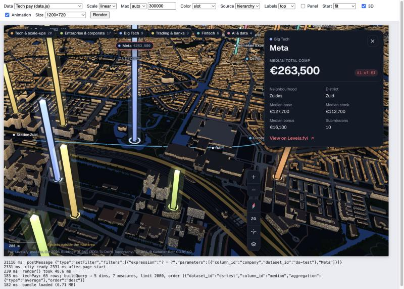
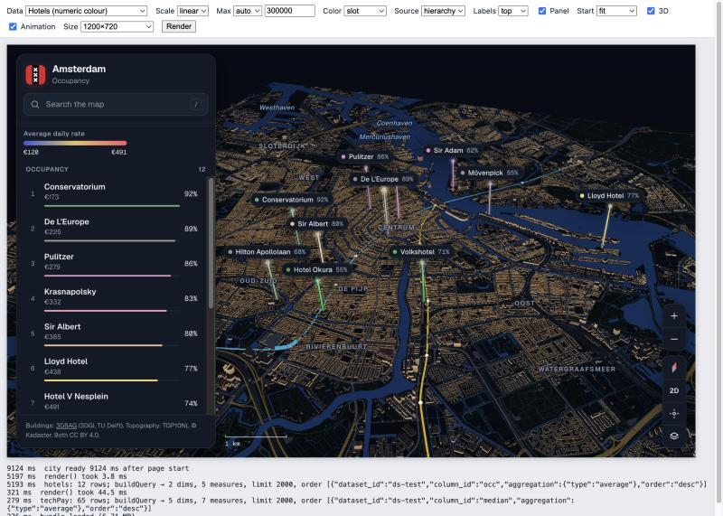

# Amsterdam map

A [Luzmo](https://www.luzmo.com) custom chart that puts your data on a 3D night map of Amsterdam. Every building is real: about 146,000 footprints with their measured heights from 3DBAG, on top of water, parks, streets, rail, trees and metro lines 52 and 54 from TOP10NL. Each row of your data becomes a glowing pillar at its coordinates, and the pillar's height shows its value.

It is a generic version of [Amsterdam Tech Pay](https://github.com/jvannistelrooy/amsterdam-pay-map), which shows what tech companies in Amsterdam pay.



## What it does

- One pillar per label, placed by latitude and longitude. Its height is linear from zero, so the largest value gets the tallest pillar. Small values get a minimum visible height, and empty, zero or negative values show only a ring on the ground.
- Pillars float just above the roofs around them instead of cutting through buildings.
- Pillars are coloured by a category (with a legend and filter chips), by a number (a gradient), by the measure itself, or in one colour.
- Hovering a pillar shows a tooltip. Clicking it opens a detail card with the value, its rank and your detail fields, and filters the rest of the dashboard on that label.
- Optional side panel with search (your points, neighbourhoods, landmarks, streets, canals and metro stations) and a ranking.
- Values are formatted with the column formats you set in Luzmo.
- Points outside the 3D area (about 14 × 14 km around the centre) are left out, and the map says how many.



## Data slots

| Slot | Label | Type | Required | Fields | What it drives |
|---|---|---|---|---|---|
| `name` | Label | category | yes | 1 | One pillar per value. Card title, search, and the column a click filters on. |
| `coordinates` | Latitude & longitude | numeric | yes | 2: latitude, then longitude (WGS84) | Pillar position. Both are averaged per label. |
| `measure` | Measure | numeric | yes | 1 | Pillar height, label value, card value and rank. |
| `color` | Color | category or numeric | no | 1 | A category gives a legend with filter chips; a number gives a gradient. |
| `details` | Details | category, date or numeric | no | up to 8 | Shown in the tooltip and the card as "column name: value". A text value that starts with `http` becomes a link button. |

The chart builds its own query: one row per label (and per colour category and text detail, if you add those). It is sorted by the measure, largest first, and capped at 2,000 rows.

## Options

| Group | Option | Values |
|---|---|---|
| Pillars | `height.scale` | Linear (default), square root, logarithmic |
| | `height.max` | Auto (largest value in the current, filtered data) or a fixed value (`height.fixedMax`), so heights stay comparable across filters |
| Colors | `color.mode` | Color slot, measure, single colour |
| | `color.source` | Hierarchy colours, then theme colours, then palette |
| | `color.palette`, `color.range`, `color.single` | Palette for categories, gradient for numbers, the single colour |
| Labels | `labels.density` | None, top N (`labels.topN`, default 12), all (at most 200) |
| | `labels.value` | Show the formatted value next to the name |
| Click & detail card | `interaction.filter` | A click filters the dashboard on the label |
| | `card.rank`, `rank.order` | Show "#N of M"; whether #1 is the highest or the lowest value |
| | `card.linkText`, `card.note` | Link button text and a note under the card |
| Side panel & footer | `panel.show`, `panel.title`, `panel.subtitle` | Search and ranking panel, off by default |
| | `footer.source` | Your data credit. The 3DBAG and TOP10NL credit is always shown. |
| Map | `camera.start` | Fit data, whole city, Centrum |
| | `camera.tilt` | 3D or top-down |
| | `map.metro`, `map.streets`, `map.districts`, `map.trees`, `map.animation` | Map layers and motion |

## Use cases

| Use case | Label | Measure | Color | Details |
|---|---|---|---|---|
| Pay per company | Company | Median total comp | Sector | Neighbourhood, base, stock, bonus, submissions, link |
| Housing prices | Postcode or street | Median price per m² | Property type | Neighbourhood, number of sales |
| Hotels or short stays | Property | Occupancy | Average daily rate (gradient) | Rooms, website |
| Store or office network | Store | Revenue | Format | Manager, footfall, conversion |
| EV charging | Station | kWh delivered | Operator | Address, sessions, uptime |
| Sensors and footfall | Sensor | Average daily count | Sensor type | Street, peak hour |
| Venues and events | Venue | Attendance | Venue type | Events, website |
| Real estate portfolio | Building | Market value | Asset class | Tenant, occupancy, floor area |

It does not suit area data (values per neighbourhood polygon; use a choropleth), data outside Amsterdam, or tens of thousands of points.

## Build

Requires Node.js 22.

```bash
npm install
npm run build
```

`npm run build` bundles the chart, validates `manifest.json` and writes `custom-chart-build-output/bundle.zip` (about 4.6 MB; the JavaScript is about 6.7 MB, as it embeds the city geometry). `npm run validate` only checks the manifest.

The chart source is in `projects/custom-chart/src`:

| File | Contents |
|---|---|
| `chart.ts` | Luzmo entry points: `render`, `resize`, `buildQuery`, and option parsing |
| `query.ts` | The query and how rows are read into points |
| `map.ts` | The map: scene, camera, labels, card, panel, controls |
| `pillars.ts` | Instanced pillar rendering |
| `city.ts` | Unpacking and building the city, and the roof-height grid |
| `encode.ts` | Pillar heights and colours |
| `data/city.bin.gz` | The city geometry, built by the scripts in the original repo |

### Test locally

`test/index.html` loads the built bundle and calls `render()` with sample rows shaped like a Luzmo query result: tech pay from the original repo, generated EV charging stations with edge cases, and hotels. Serve the repository root and open the page:

```bash
python3 -m http.server 4452
```

Then go to <http://localhost:4452/test/index.html>.

`npm run start` also starts the Luzmo custom chart builder, where you can try the chart against your own Luzmo datasets.

## Upload to Luzmo

Copy `.env.example` to `.env.local` and fill in a Luzmo API key and token that can manage custom charts. Then:

```bash
npm run charts -- upload --type amsterdam-map --name "Amsterdam map"
```

This builds, validates and uploads a new chart. To replace the code of a chart you uploaded before, use `npm run charts -- upload --id <chart id>`. See the [Luzmo custom chart guide](https://developer.luzmo.com/guide/guides--custom-charts) for more.

## Limits

- Only Amsterdam: the geometry is embedded in the bundle, and Luzmo's custom chart sandbox doesn't allow loading it from elsewhere.
- The map uses its own dark style and doesn't follow the dashboard theme, apart from theme colours for categories.
- At most 2,000 points and 200 point labels.

## Credits

- Based on [Amsterdam Tech Pay](https://github.com/jvannistelrooy/amsterdam-pay-map) (MIT).
- Built with the [Luzmo custom chart builder](https://github.com/luzmo-official/custom-chart-builder).
- **Buildings:** [3DBAG](https://3dbag.nl) by 3DGI and the 3D Geoinformation group at TU Delft, licensed [CC BY 4.0](https://creativecommons.org/licenses/by/4.0/).
- **Topography:** [TOP10NL](https://www.kadaster.nl/zakelijk/producten/geo-informatie/topnl) © Kadaster, via [PDOK](https://www.pdok.nl), licensed CC BY 4.0.
- **Test data:** `test/data.js` comes from the original repo: Levels.fyi medians for the Greater Amsterdam Area, retrieved 20 October 2026.
- **3D engine:** [three.js](https://threejs.org) r128 (MIT).

## Licence

This repository mixes three licences; `LICENSE` lists exactly which files fall under each.

- **The chart code** in `projects/custom-chart/src/`, the test page in `test/` and the screenshots in `docs/` are MIT licensed.
- **The rest of the repository** is the [Luzmo custom chart builder](https://github.com/luzmo-official/custom-chart-builder), copyright Luzmo and included with permission. It is not covered by the MIT licence.
- **The map data** in `projects/custom-chart/src/data/` keeps the CC BY 4.0 licences of its sources listed above, and the chart always shows their credit.

The chart depends on Luzmo npm packages (`@luzmo/dashboard-contents-types`, `@luzmo/analytics-components-kit`), which are licensed under the Luzmo Terms of Service.
